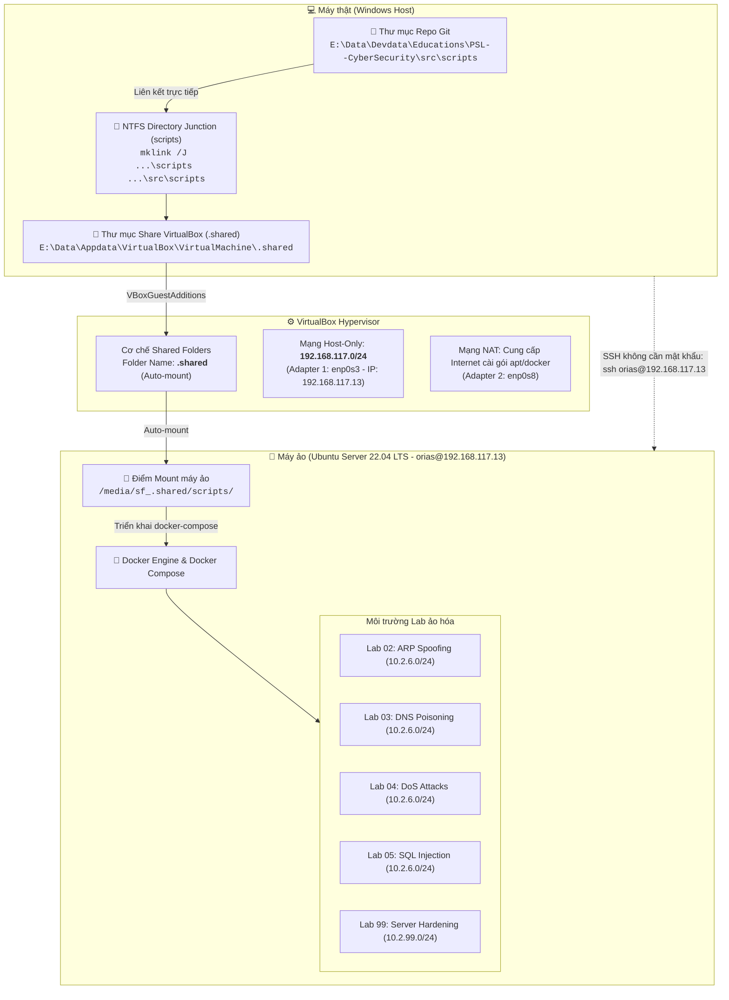

# HƯỚNG DẪN THIẾT LẬP MÔI TRƯỜNG THỰC NGHIỆM VÀ LIÊN KẾT SHARE LÊN SERVER

Tài liệu này hướng dẫn chi tiết quy trình thiết lập từ đầu (from scratch) để liên kết mã nguồn của dự án từ máy thật (**Windows Host**) sang máy ảo (**Ubuntu Server VM**) thông qua cơ chế **VirtualBox Shared Folder + NTFS Junction**, giúp thực thi trọn bộ kịch bản thực hành (Lab 01 – Lab 05, Lab 99) đồng bộ theo thời gian thực mà không cần copy hay push/pull thủ công.

---

## 1. Kiến trúc tổng thể hệ thống (Architecture Overview)



### Ưu điểm vượt trội của mô hình này:
1. **Đồng bộ thời gian thực (Zero-latency Sync):** Chỉnh sửa mã nguồn trên Windows (VS Code, Antigravity, Git) sẽ phản ánh ngay lập tức bên trong máy ảo và các container Docker mà không cần lệnh copy trung gian.
2. **Tiết kiệm dung lượng:** Không nhân bản dữ liệu, toàn bộ dữ liệu nằm trên một phân vùng duy nhất của ổ đĩa máy thật.
3. **Phân quyền và cô lập:** Mọi lệnh tấn công, bắt gói tin, chạy docker chỉ diễn ra bên trong môi trường máy ảo, an toàn tuyệt đối cho máy host.

---

## 2. Thông số môi trường chuẩn (Default Environment Parameters)

| Thành phần | Giá trị cấu hình | Mô tả |
| :--- | :--- | :--- |
| **Hệ điều hành máy thật** | Windows 11 / 10 64-bit | Chứa thư mục dự án Git |
| **Đường dẫn thư mục dự án** | `E:\Data\Devdata\Educations\PSL--CyberSecurity` | Root repository |
| **Đường dẫn scripts trên Windows** | `E:\Data\Devdata\Educations\PSL--CyberSecurity\src\scripts` | Nơi chứa mã nguồn các lab |
| **Thư mục chia sẻ VirtualBox** | `E:\Data\Appdata\VirtualBox\VirtualMachine\.shared` | Folder share lên VM |
| **Hệ điều hành máy ảo** | Ubuntu Server 22.04 LTS (x86_64) | Tên máy: `vserver` / `osboxes` |
| **Tài khoản người dùng máy ảo** | `orias` (Mật khẩu mặc định: `orias`) | Cấp quyền `sudo NOPASSWD` |
| **IP mạng Host-Only (Adapter 1)**| `192.168.117.13/24` (Interface: `enp0s3`) | Kết nối SSH từ máy Windows |
| **IP mạng NAT (Adapter 2)** | DHCP cấp phát (Interface: `enp0s8`) | Ra Internet tải apt / docker |
| **Đường dẫn mount trên server** | `/media/sf_.shared/scripts/` | Thư mục ánh xạ trực tiếp từ host |

---

## 3. Quy trình thiết lập từng bước (Step-by-Step Setup)

### BƯỚC 1: Cấu hình thư mục chia sẻ và tạo Junction trên Windows Host

Mở **Command Prompt (cmd.exe)** hoặc **PowerShell** bằng quyền Administrator trên máy Windows:

1. Tạo thư mục chia sẻ gốc VirtualBox (nếu chưa có):
   ```cmd
   mkdir "E:\Data\Appdata\VirtualBox\VirtualMachine\.shared"
   ```

2. Tạo liên kết **Directory Junction** trỏ `scripts` sang thư mục mã nguồn dự án:
   ```cmd
   mklink /J "E:\Data\Appdata\VirtualBox\VirtualMachine\.shared\scripts" "E:\Data\Devdata\Educations\PSL--CyberSecurity\src\scripts"
   ```

   > [!TIP]
   > Lệnh `mklink /J` tạo một NTFS Junction trỏ thẳng tới `src\scripts`. VirtualBox sẽ đọc liên kết này như một thư mục vật lý thông thường mà không cần cấp quyền đặc quyền symbolic link.

3. Kiểm tra liên kết đã tạo thành công:
   ```cmd
   dir "E:\Data\Appdata\VirtualBox\VirtualMachine\.shared"
   ```
   *Kết quả xuất hiện dòng `<JUNCTION> scripts [...]` là đã thành công.*

---

### BƯỚC 2: Cấu hình máy ảo trong VirtualBox Manager

Tắt máy ảo trước khi chỉnh sửa phần cứng:

1. **Cấu hình Card mạng (Network Adapters):**
   - **Adapter 1:** Chọn **Host-only Adapter** $\rightarrow$ Chọn card mạng ảo của VirtualBox (ví dụ: `VirtualBox Host-Only Ethernet Adapter` cấu hình dải `192.168.117.0/24`).
   - **Adapter 2:** Chọn **NAT** $\rightarrow$ Đảm bảo máy ảo có mạng Internet để cài gói `apt` và pull Docker image.

2. **Cấu hình Shared Folders:**
   - Vào **Settings** của máy ảo $\rightarrow$ Mục **Shared Folders** $\rightarrow$ Nhấn biểu tượng dấu **+** (Add Shared Folder):
     - **Folder Path:** `E:\Data\Appdata\VirtualBox\VirtualMachine\.shared`
     - **Folder Name:** `.shared`
     - **Tùy chọn:** Tích chọn **Auto-mount** và **Make Permanent** *(KHÔNG tích Read-only)*.
     - Nhấn **OK** để lưu lại.

---

### BƯỚC 3: Cài đặt tiện ích máy khách (Guest Additions) và gói phần mềm trên Ubuntu Server

Khởi động máy ảo Ubuntu Server và đăng nhập tài khoản `orias`:

1. Cập nhật hệ thống và cài đặt Guest Additions:
   ```bash
   sudo apt update
   sudo apt install -y virtualbox-guest-utils virtualbox-guest-x11 build-essential dkms
   ```

2. Cài đặt Docker và Docker Compose:
   ```bash
   sudo apt install -y docker.io docker-compose
   sudo systemctl enable --now docker
   ```

3. Cài đặt các công cụ mạng phục vụ kiểm thử và phân tích luồng gói:
   ```bash
   sudo apt install -y wireshark tshark tcpdump net-tools nmap hping3 curl python3-pip
   ```

---

### BƯỚC 4: Phân quyền người dùng và cấp Sudo không mật khẩu (NOPASSWD)

Để người dùng `orias` có toàn quyền đọc/ghi vào thư mục mount `/media/sf_.shared` và chạy Docker không cần `sudo`, thực hiện một trong hai cách:

#### Cách 4.1: Sử dụng Script tự động `setup.py` từ máy Host Windows (Khuyên dùng)
Tại thư mục gốc dự án trên máy Windows, mở terminal và chạy:
```powershell
python src\scripts\setup.py --host 192.168.117.13 --user orias --password orias
```
*Script sẽ tự động kết nối qua SSH, thêm user vào nhóm `vboxsf`, `docker` và cấu hình file `/etc/sudoers.d/orias`.*

#### Cách 4.2: Cấu hình thủ công trên Ubuntu Server
Gõ trực tiếp các lệnh sau trên terminal Ubuntu Server:
```bash
# 1. Thêm user vào nhóm vboxsf (để đọc/ghi Shared Folder) và nhóm docker
sudo usermod -aG vboxsf,docker $USER

# 2. Cấp quyền sudo không cần hỏi mật khẩu (phục vụ tự động hóa kịch bản)
echo "$USER ALL=(ALL:ALL) NOPASSWD:ALL" | sudo tee /etc/sudoers.d/$USER
sudo chmod 0440 /etc/sudoers.d/$USER

# 3. Kích hoạt nhóm mới cho phiên hiện tại (hoặc logout và login lại)
newgrp vboxsf
```

---

### BƯỚC 5: Cấu hình SSH Key để kết nối nhanh từ Windows không cần gõ mật khẩu

Mở **PowerShell** trên máy Windows:

1. Tạo cặp khóa SSH (nếu chưa có):
   ```powershell
   ssh-keygen -t ed25519 -C "admin@security-lab"
   ```
   *(Nhấn Enter liên tục để dùng đường dẫn mặc định `~/.ssh/id_ed25519` và bỏ qua passphrase).*

2. Đẩy Public Key lên máy ảo Ubuntu Server:
   ```powershell
   ssh orias@192.168.117.13 "mkdir -p ~/.ssh && chmod 700 ~/.ssh"
   Get-Content ~\.ssh\id_ed25519.pub | ssh orias@192.168.117.13 "cat >> ~/.ssh/authorized_keys && chmod 600 ~/.ssh/authorized_keys"
   ```

3. Kiểm tra kết nối không cần nhập mật khẩu:
   ```powershell
   ssh orias@192.168.117.13 "uname -a"
   ```
   *Nếu hiển thị thông tin kernel Linux ngay lập tức mà không hỏi mật khẩu là đã thành công.*

---

### BƯỚC 6: Kiểm tra mount và xác thực tính đồng bộ của dự án

1. Kiểm tra trạng thái mount trên máy ảo:
   ```bash
   ssh orias@192.168.117.13 "mount | grep sf_"
   ```
   *Kết quả chuẩn:*
   ```text
   .shared on /media/sf_.shared type vboxsf (rw,nodev,relatime)
   ```

2. Kiểm tra danh sách thư mục các bài lab:
   ```bash
   ssh orias@192.168.117.13 "ls -la /media/sf_.shared/scripts"
   ```
   *Bạn sẽ thấy đầy đủ các thư mục `lab01`, `lab02`, `lab03`, `lab04`, `lab05`, `lab99` cùng các file `setup.py`, `gendocs.py`, `genimgs.py`.*

3. Thử tạo hoặc sửa một file trên máy Windows và kiểm tra trên máy ảo:
   - Sửa bất kỳ dòng nào trong `src/scripts/lab04/demo.md` trên Windows.
   - Chạy lệnh kiểm tra trên máy ảo:
     ```bash
     ssh orias@192.168.117.13 "head -n 5 /media/sf_.shared/scripts/lab04/demo.md"
     ```
   - Nội dung thay đổi lập tức có hiệu lực.

---

## 4. Hướng dẫn chạy nhanh các bài Lab từ Windows qua SSH

Sau khi đã hoàn tất thiết lập trên, bạn có thể đứng tại máy Windows và điều khiển toàn bộ quá trình demo các bài lab một cách nhẹ nhàng:

```powershell
# ==========================================
# 1. KẾT NỐI VÀO SERVER
# ==========================================
ssh orias@192.168.117.13

# ==========================================
# 2. CHẠY THỬ NGHIỆM LAB 02 (ARP SPOOFING)
# ==========================================
cd /media/sf_.shared/scripts/lab02
bash .lab/00_init.sh
bash .lab/01_scenario1.sh
bash .lab/02_scenario2.sh
bash .lab/03_scenario3.sh
bash .lab/04_fix_server.sh
bash .lab/99_down.sh

# ==========================================
# 3. CHẠY THỬ NGHIỆM LAB 03 (DNS POISONING)
# ==========================================
cd /media/sf_.shared/scripts/lab03
bash .lab/00_init.sh
bash .lab/01_gen_query.sh
bash .lab/02_gen_response.sh
bash .lab/03_test_attack.sh
bash .lab/04_test_defense.sh
bash .lab/99_down.sh

# ==========================================
# 4. CHẠY THỬ NGHIỆM LAB 04 (DoS & DEFENSE)
# ==========================================
cd /media/sf_.shared/scripts/lab04
bash .lab/00_init.sh
bash .lab/01_scenario1.sh
bash .lab/02_scenario2.sh
bash .lab/03_scenario3.sh
bash .lab/04_test_defense.sh
bash .lab/99_down.sh

# ==========================================
# 5. CHẠY THỬ NGHIỆM LAB 05 (SQL INJECTION)
# ==========================================
cd /media/sf_.shared/scripts/lab05
bash .lab/00_init.sh
bash .lab/01_example1_select.sh
bash .lab/02_example2_insert.sh
bash .lab/03_test_defense.sh
bash .lab/99_down.sh

# ==========================================
# 6. CHẠY BÀI TẬP LỚN LAB 99 (MULTI-LAYER DEFENSE & ATTACK VERIFICATION)
# ==========================================
cd /media/sf_.shared/scripts/lab99
bash .lab/00_init.sh                  # 1. Khoi tao Target (10.2.99.10) & Assessor (10.2.99.20)
bash .lab/01_baseline_audit.sh         # 2. Kiem toan chi so Lynis truoc gia co
bash .lab/02_assess_surface.sh before  # 3. Tham do be mat bang Nmap truoc gia co (Lab 01)
bash .lab/03_harden.sh                 # 4. Trien khai gia co he thong da tang
bash .lab/04_verify_harden.sh          # 5. Xac minh cau hinh gia co tren Target
bash .lab/05_reassess.sh               # 6. Tai kiem toan chi so Lynis sau gia co
bash .lab/06_compare_report.sh         # 7. So sanh dinh luong Before vs After
bash .lab/08_apply_lab02.sh            # 8. Assessor tan cong ARP Spoofing -> Kiem chung phong thu L2/L3 (Lab 02)
bash .lab/09_apply_lab03.sh            # 9. Assessor tham dinh DNS -> Kiem chung Source Port Randomization (Lab 03)
bash .lab/11_apply_lab04.sh            # 10. Assessor tan cong DoS SYN Flood -> Kiem chung SYN Cookies (Lab 04)
bash .lab/12_apply_lab05.sh            # 11. Assessor tan cong SQLi -> Kiem chung Prepared Statements (Lab 05)
bash .lab/10_summary_project.sh        # 12. Tong hop bao cao toan dien vao project_summary.md
bash .lab/99_down.sh                   # 13. Dong moi truong Lab 99
```

---

## 5. Xử lý các sự cố thường gặp (Troubleshooting)

### 1. Bị lỗi `Permission denied` khi truy cập `/media/sf_.shared`
- **Nguyên nhân:** User chưa được nạp vào nhóm `vboxsf` trong phiên đăng nhập hiện tại.
- **Khắc phục:**
  ```bash
  sudo usermod -aG vboxsf $USER
  newgrp vboxsf
  # Hoặc đăng xuất SSH và đăng nhập lại
  ```

### 2. Máy ảo reboot xong không tự mount `/media/sf_.shared`
- **Nguyên nhân:** Dịch vụ VirtualBox Guest Additions khởi động trễ hơn fstab.
- **Khắc phục:** Thêm dòng sau vào cuối `/etc/fstab`:
  ```bash
  echo ".shared /media/sf_.shared vboxsf defaults,uid=1000,gid=1000 0 0" | sudo tee -a /etc/fstab
  # Hoặc chạy lệnh mount thủ công:
  sudo mount -t vboxsf .shared /media/sf_.shared
  ```

### 3. Máy ảo bị mất mạng Internet do xung đột Default Gateway
- **Nguyên nhân:** Mạng Host-Only cấp default gateway ưu tiên hơn card NAT.
- **Khắc phục:** Xóa gateway của mạng Host-Only (các script `00_init.sh` đã tự động xử lý):
  ```bash
  sudo ip route del default via 192.168.117.2 2>/dev/null || true
  ```

### 4. Lỗi xung đột dải mạng `10.2.6.0/24` giữa các bài Lab 02, 03, 04, 05
- **Nguyên nhân:** Do các bài lab dùng chung subnet `10.2.6.0/24`, nếu chưa tắt lab trước thì lab sau sẽ không thể khởi tạo network Docker.
- **Khắc phục:** Chỉ cần chạy script `bash .lab/99_down.sh` của bài lab vừa hoàn thành trước khi chuyển sang lab kế tiếp. Các script `00_init.sh` cũng đã được lập trình sẵn để tự động dọn dẹp các lab lân cận.

### 5. Lỗi `\r: command not found` khi chạy script shell
- **Nguyên nhân:** File script bị lưu với định dạng dòng Windows CRLF (`\r\n`).
- **Khắc phục:** Chuyển đổi định dạng sang Unix LF (`\n`):
  ```bash
  sed -i 's/\r$//' <file.sh>
  ```
